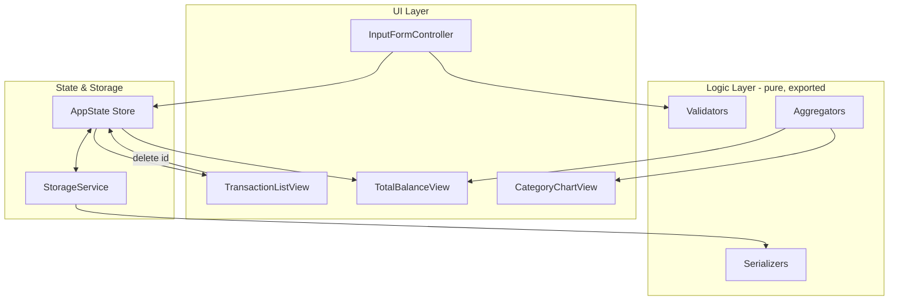
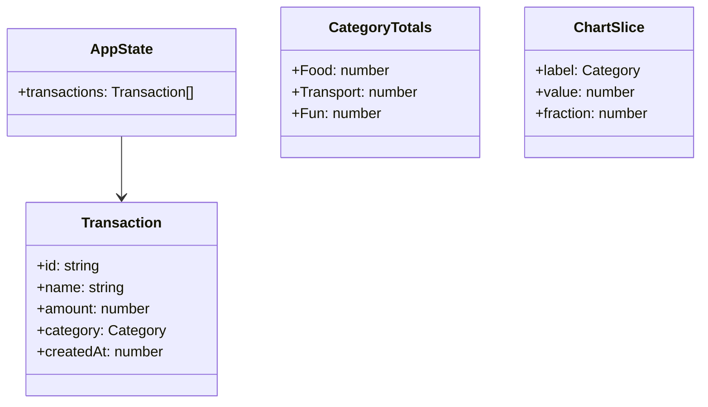

# Design Document

## Introduction

This design document translates the approved requirements for the **Expense & Budget Visualizer** into a concrete technical design. It covers the system architecture, components and their interfaces, data models, correctness properties, error handling, and testing strategy. The application is a fully client-side web app built with HTML, CSS, and vanilla JavaScript that persists data in the browser's Local Storage.

## Overview

### Purpose

The Expense & Budget Visualizer lets a user record expense transactions (item name, amount, category), review them in a scrollable list, see a running total balance, and visualize spending distribution by category in a pie chart. Everything runs in the browser with no backend.

### Goals

- Provide the four MVP features: input form, transaction list, total balance, and category pie chart.
- Persist all data client-side via Local Storage so it survives page reloads.
- Keep the runtime application dependency-free (no third-party frontend frameworks or JavaScript libraries) per Requirement 10.1.
- Keep the shipped codebase minimal: one CSS file in `css/` and one JavaScript file in `js/`.

### Scope

In scope: adding/deleting transactions, validation, list rendering, total balance, pie chart, Local Storage persistence, and cross-browser support for modern Chrome, Firefox, Edge, and Safari.

Out of scope: editing existing transactions, budgets/income, multi-currency, accounts, server sync, and any feature beyond the approved requirements.

### Key Design Decisions

1. **Vanilla SVG pie chart instead of Chart.js.** The user request suggested Chart.js, but Requirement 10.1 explicitly forbids external frontend frameworks and third-party JavaScript libraries. The requirements are authoritative in the Requirements-First workflow, so the chart is rendered with hand-rolled SVG computed from category aggregates. This keeps the runtime app dependency-free and still satisfies the visualization requirements. The tradeoff is more implementation effort for the chart, gained zero runtime dependencies and full control over styling/accessibility.

2. **Pure logic separated from DOM code within a single JS file.** All data transformations (validation, total, category aggregation, serialization) are written as pure functions with no DOM or storage dependencies and exported from the module. DOM/storage code calls these functions. This makes the logic unit- and property-testable in isolation while still respecting the single-JS-file rule, because tests import only the pure exports and never run DOM bootstrap.

3. **ES Modules for the shipped app.** The single `js/app.js` file is loaded as `<script type="module">`. Pure functions are `export`ed; the UI bootstrap is a single `init()` that only runs when the DOM is ready. ES modules are supported in all target browsers and in extension popup pages, and importing the module in tests does not auto-run UI code. This is the cleanest way to keep one JS file while remaining testable.

4. **Test-only dependencies are separate from the shipped app.** Property-based testing uses `fast-check` (a dev-only dependency, never shipped). Requirement 10.1 governs the built application's runtime, not the development toolchain, so test libraries do not violate the no-third-party-library constraint for the shipped app. The shipped app remains one HTML file, one CSS file, one JS file, with no runtime third-party libraries.

5. **In-memory state is the source of truth; Local Storage is a persistence mirror.** The app keeps an in-memory array of transactions and writes a serialized copy to Local Storage on every mutation. On load it reads Local Storage back into memory. If storage is unavailable or a write fails, the in-memory array is preserved and the user is warned (Requirements 6.5, 10.3).

## Architecture

### Layered Structure

The application is organized into three logical layers, all contained in the single `js/app.js` module:

1. **Logic layer (pure functions, exported).** Validation, transaction creation, deletion, total calculation, category aggregation, chart-slice computation, and JSON serialize/deserialize. These have no side effects and no DOM/storage access, which makes them the target of property-based tests.
2. **State & storage layer.** Holds the in-memory `AppState` (the transaction array) and a `StorageService` that wraps Local Storage with availability checks and error handling. Mutations produce a new state and trigger persistence plus re-render.
3. **UI layer (side-effectful, not exported).** Controllers and views that read from state, render the list, total, and chart into the DOM, and wire form submission and delete-button events.

### Data Flow

```mermaid
flowchart LR
    U[User] -->|fills & submits| Form[Input Form]
    Form -->|raw input| Validate[validateTransaction]
    Validate -->|invalid| Msgs[Validation Messages]
    Validate -->|valid| Create[createTransaction]
    Create --> State[(AppState: transactions[])]
    State -->|render| List[Transaction List View]
    State -->|aggregate + render| Total[Total Balance View]
    State -->|aggregate + render| Chart[Category Chart View]
    State -->|serialize| LS[(Local Storage)]
    LS -->|deserialize on load| State
    List -->|delete by id| Delete[deleteTransaction]
    Delete --> State
```

### Component Layout



### Runtime Behavior

On `DOMContentLoaded`, `init()` loads any saved transactions from Local Storage into the in-memory store, renders the list/total/chart (or their empty states), and attaches event handlers. Each user action (add or delete) mutates the in-memory store, persists the new state, and re-renders the affected views synchronously. Because the total and chart are pure functions of the current store, they are always consistent with the list after every mutation.

## Components and Interfaces

All logic-layer functions are exported from `js/app.js` so tests can import them directly. UI functions are internal to the module. Interfaces use the following notation: `name(params): ReturnType`.

### Logic Layer (pure, exported)

- `validateTransaction(input: RawInput): ValidationResult`
  - Returns `{ valid: boolean, errors: string[] }`. `RawInput = { name: string, amount: string, category: string }` where `amount` is the raw form string so decimal-place validation is exact.
- `createTransaction(input: RawInput): Transaction`
  - Precondition: `input` is valid. Produces a `Transaction` with a generated `id` and `createdAt`.
- `deleteTransaction(transactions: Transaction[], id: string): Transaction[]`
  - Returns a new array excluding the transaction with the given `id`. Pure; does not mutate the input.
- `calculateTotal(transactions: Transaction[]): number`
  - Returns the arithmetic sum of all `amount` values.
- `formatCurrency(amount: number): string`
  - Returns `amount` formatted with exactly two decimal places (e.g., `12.5` -> `"12.50"`).
- `aggregateByCategory(transactions: Transaction[]): CategoryTotals`
  - Returns `{ Food: number, Transport: number, Fun: number }` summing amounts per category.
- `computeChartSlices(transactions: Transaction[]): ChartSlice[]`
  - Returns one `ChartSlice = { label: string, value: number, fraction: number }` per category with total greater than zero, where `fraction = value / grandTotal`. Returns `[]` when there are no transactions.
- `serialize(transactions: Transaction[]): string`
  - Returns a JSON string of the stored representation.
- `deserialize(json: string): Transaction[]`
  - Returns the transaction array parsed from `json`. Tolerates a missing/corrupt key by returning `[]`.
- `sortByNewest(transactions: Transaction[]): Transaction[]`
  - Returns transactions ordered by `createdAt` descending (newest first).
- `generateId(): string`
  - Returns a unique id using `crypto.randomUUID()` when available, falling back to a timestamp-plus-random string.

### State & Storage Layer

- `AppState`: a module-level `{ transactions: Transaction[] }` object. Mutations replace the array reference so views always read the current snapshot.
- `StorageService`:
  - `isAvailable(): boolean` — probes Local Storage with a test write/read.
  - `save(transactions: Transaction[]): SaveResult` — returns `{ ok: boolean, error?: string }`. Serializes and writes; catches quota/availability errors.
  - `load(): Transaction[]` — reads and deserializes stored transactions, or `[]` if none/unavailable.

### UI Layer (internal)

- `init(): void` — bootstrap. Loads storage, renders views, attaches handlers. Only invoked when the DOM container exists, so importing the module in tests is side-effect free.
- `renderTransactionList(transactions: Transaction[]): void` — rebuilds the scrollable list rows, showing an empty-state element when the array is empty.
- `renderTotal(transactions: Transaction[]): void` — sets the total balance display to `formatCurrency(calculateTotal(...))`, or `"0.00"` when empty.
- `renderChart(transactions: Transaction[]): void` — renders the SVG pie chart from `computeChartSlices(...)`, or an empty-state indication when there are no slices.
- `handleFormSubmit(event: SubmitEvent): void` — validates input; on success creates and adds the transaction, clears the form, persists, and re-renders; on failure shows validation messages and does not add.
- `handleDelete(id: string): void` — removes the transaction, persists, and re-renders the list, total, and chart.
- `showValidationError(errors: string[]): void` — renders validation messages near the form.
- `showPersistenceError(message: string): void` — renders a non-blocking persistence-failure message.

## Data Models

### Transaction



- `id: string` — unique identifier for delete targeting and round-trip matching. Generated by `generateId()`.
- `name: string` — the item name, length 1 to 50 characters (Requirement 1.1, 1.3). Stored as entered after trimming leading/trailing whitespace.
- `amount: number` — the cost. Constrained to a positive number not exceeding `999999.99` with at most two decimal places (Requirement 1.3, 1.5). Stored as a `number`; validated from the raw string before parsing.
- `category: Category` — one of `"Food" | "Transport" | "Fun"` (Requirement 1.2).
- `createdAt: number` — `Date.now()` at creation, used to order the list newest-first (Requirement 2.1) and to keep ordering stable across save/load.

### Stored Representation

Transactions are persisted to Local Storage under a single key (e.g., `"expense-visualizer:transactions"`) as a JSON array of objects:

```json
[
  { "id": "uuid", "name": "Lunch", "amount": 12.5, "category": "Food", "createdAt": 1700000000000 }
]
```

The round-trip property (Requirement 6.4) requires that count is preserved and every original transaction has a loaded counterpart with identical `name`, `amount`, and `category`. `id` and `createdAt` are also persisted so ordering and delete targeting survive reload.

### Validation Rules

Input is validated by `validateTransaction` against these rules, which together define the accept/reject partition:

- `name`: required; after trimming must be 1 to 50 characters. Whitespace-only is treated as empty (Requirement 1.4).
- `amount`: required; must be a positive number, greater than zero, not exceeding `999999.99`, with at most two decimal places (Requirement 1.3, 1.5). The raw string is checked with a pattern such as `/^\d+(\.\d{1,2})?$/` after trimming, then range-validated, so values like `12.345` or `0` or `-5` or `1000000` are rejected.
- `category`: required; must be one of `Food`, `Transport`, `Fun` (Requirement 1.2).

### Category Constants

The three categories are defined as a single constant array `CATEGORIES = ["Food", "Transport", "Fun"]` used to populate the select and to key the aggregation, ensuring the form options and the chart aggregation can never drift out of sync.

## Correctness Properties

*A property is a characteristic or behavior that should hold true across all valid executions of a system-essentially, a formal statement about what the system should do. Properties serve as the bridge between human-readable specifications and machine-verifiable correctness guarantees.*

The pure logic layer is amenable to property-based testing: validation, totals, category aggregation, deletion, and serialization are pure functions over a large input space, with universal properties that hold across all valid inputs. UI rendering, DOM interactions, storage I/O, cross-browser behavior, and performance SLAs are covered by integration and smoke tests instead (see Testing Strategy).

### Property 1: Validation accepts exactly the valid inputs

*For any* raw input, `validateTransaction` shall accept it if and only if the name (after trimming) is 1 to 50 characters, the amount (raw string) is a positive number not exceeding `999999.99` with at most two decimal places, and the category is one of Food, Transport, or Fun; all other inputs shall be rejected with at least one error.

**Validates: Requirements 1.3, 1.4, 1.5**

### Property 2: Transaction list is ordered newest-first

*For any* set of transactions with distinct `createdAt` values, the rendered order shall be strictly descending by `createdAt`, so the most recently added transaction appears first.

**Validates: Requirements 2.1**

### Property 3: Each row contains the transaction's name, amount, and category

*For any* transaction, the data mapped to its list row shall contain the transaction's name, its amount formatted with two decimal places, and its category.

**Validates: Requirements 2.2**

### Property 4: Delete removes exactly the targeted transaction

*For any* transaction set containing a transaction `T`, after `deleteTransaction(set, T.id)` the resulting set shall not contain `T` (by id) and shall have exactly one fewer element than the original set.

**Validates: Requirements 3.2**

### Property 5: Total balance equals the sum of amounts, with empty mapping to zero

*For any* transaction set, `formatCurrency(calculateTotal(set))` shall equal the arithmetic sum of all amounts formatted with exactly two decimal places; and for the empty set it shall equal `"0.00"`.

**Validates: Requirements 4.2, 4.4**

### Property 6: Chart slices are proportional and cover the whole, empty maps to no slices

*For any* transaction set, `computeChartSlices` shall emit a slice only for each category whose total is greater than zero; each slice's `fraction` shall equal that category's total divided by the grand total (the sum of all category totals); the fractions shall sum to 1 (within floating-point tolerance) whenever at least one category is non-zero; the sum of slice `value`s shall equal `calculateTotal(set)`; and for the empty set it shall return no slices (empty state).

**Validates: Requirements 5.2, 5.4**

### Property 7: Serialization round-trip preserves count and field values

*For any* set of between 1 and 1,000 valid transactions, deserializing the serialized set shall produce a set with the same count, where every original transaction has a corresponding loaded transaction with identical `name`, `amount`, and `category` values.

**Validates: Requirements 6.4**

## Error Handling

### Input Validation Errors

When the form is submitted with invalid input, no transaction is added and the user is shown a message identifying the problem (Requirements 1.4, 1.5). Specific cases:

- Any required field empty or whitespace-only (name) -> "Please fill in all required fields" with the offending fields indicated.
- Amount not a positive number, exceeding `999999.99`, or with more than two decimal places -> "Amount must be a positive number not exceeding 999,999.99 with at most 2 decimal places".
- Category missing or not in the allowed set -> treated as an empty required field.

Validation messages are rendered near the form and cleared on the next successful submission.

### Local Storage Errors

If Local Storage is unavailable or a write fails (e.g., quota exceeded), the application retains the current transactions in memory and shows a non-blocking error message indicating that persistence failed (Requirements 6.5, 10.3). `StorageService.save` returns a `{ ok: false, error }` result so the UI can display the message without losing in-memory data. On load, if storage is unavailable or contains no data, the app initializes with an empty list (Requirement 6.3).

### Empty States

- No transactions: the list shows an empty-state indication (Requirement 2.5), the total shows `0.00` (Requirement 4.4), and the chart shows an empty state with a "no spending data" indication (Requirement 5.4).
- No spending in a given category: that category simply produces no chart slice (Requirement 5.2).

### Cross-Browser Robustness

The code avoids non-standard APIs. `crypto.randomUUID()` is guarded with a fallback id generator so older-but-modern engines still work. All interactions must complete without emitting JavaScript console errors in the target browsers (Requirement 7.3).

## Testing Strategy

### Dual Testing Approach

- **Property tests** verify universal properties of the pure logic layer across many generated inputs.
- **Unit tests** verify concrete examples, boundary conditions, and edge cases.
- **Integration/smoke tests** verify DOM interactions, persistence I/O, cross-browser rendering, and performance SLAs.

Property-based testing applies here because the logic layer consists of pure functions (validation, totals, aggregation, deletion, serialization) with universal properties over a large input space. UI rendering, DOM I/O, storage, cross-browser, and performance concerns are not suitable for PBT and are covered by example/integration/smoke tests.

### Property-Based Tests

Use `fast-check` (dev-only dependency, not shipped) for the properties in the Correctness Properties section. Each test runs a minimum of 100 iterations and is tagged with a comment referencing the design property.

- **Property 1 (Validation partition):** `fast-check` arbitrary `RawInput` covering valid and invalid names/amounts/categories; assert `validateTransaction` accepts exactly the valid ones. Tag: `Feature: expense-budget-visualizer, Property 1: Validation accepts exactly the valid inputs`.
- **Property 2 (Newest-first ordering):** arbitrary transaction sets with distinct `createdAt`; assert `sortByNewest` is descending. Tag: `Feature: expense-budget-visualizer, Property 2: Transaction list is ordered newest-first`.
- **Property 3 (Row content):** arbitrary transactions; assert the row-data mapping contains name, `formatCurrency(amount)`, and category. Tag: `Feature: expense-budget-visualizer, Property 3: Each row contains the transaction's name, amount, and category`.
- **Property 4 (Delete removes exactly one):** arbitrary sets containing a chosen `T`; assert `deleteTransaction` excludes `T` and shrinks by one. Tag: `Feature: expense-budget-visualizer, Property 4: Delete removes exactly the targeted transaction`.
- **Property 5 (Total):** arbitrary sets including the empty set; assert `formatCurrency(calculateTotal(...))` equals the summed-and-formatted total, and `0.00` for empty. Tag: `Feature: expense-budget-visualizer, Property 5: Total balance equals the sum of amounts, with empty mapping to zero`.
- **Property 6 (Chart slices):** arbitrary sets including the empty set; assert only `>0` categories appear, `fraction = value / grandTotal`, fractions sum to 1, slice values sum to the total, and empty -> no slices. Tag: `Feature: expense-budget-visualizer, Property 6: Chart slices are proportional and cover the whole, empty maps to no slices`.
- **Property 7 (Serialization round-trip):** arbitrary sets of 1 to 1,000 valid transactions; assert `deserialize(serialize(set))` preserves count and matches `name`, `amount`, `category` for every original. Tag: `Feature: expense-budget-visualizer, Property 7: Serialization round-trip preserves count and field values`.

### Unit Tests

Focus on concrete examples, boundaries, and edge cases:

- Form structure: three fields exist; name `maxlength=50`; category select has exactly Food, Transport, Fun.
- Amount boundaries: `0.01`, `999999.99` accepted; `0`, `-1`, `1000000`, `12.345`, non-numeric, empty rejected; name length `1` and `50` accepted, `51` rejected; whitespace-only name rejected.
- Total edge case: empty set -> `"0.00"`.
- Chart edge case: empty set -> no slices and empty-state indication; single category -> fraction `1`.
- Delete: removing the last transaction leaves an empty list with empty states.
- Form clearing: after a valid add, all form fields are cleared.
- Font sizing: body text computed size >= 16px, secondary/helper text >= 14px (Requirement 9.2); primary action larger than secondary (Requirement 9.1).

### Integration and Smoke Tests

Use a DOM environment (e.g., `jsdom` or a real browser via a lightweight runner) for side-effectful behavior:

- Add via form submit renders a new row, updates total and chart, clears the form, and persists to Local Storage (mocked or real).
- Delete button removes the row and updates total and chart.
- Load on `init` reads Local Storage and renders saved transactions; empty storage initializes empty with empty states.
- Storage failure: make `StorageService.save` throw or report unavailable; assert in-memory data is retained and a persistence error is shown.
- No-reload updates: add/delete without a full page navigation.
- Scrollable list: render more rows than the container height; assert the container is scrollable.
- No external network: stub `fetch`/`XMLHttpRequest`; assert none are invoked (Requirements 7.2, 10.2).
- No console errors during supported interactions (Requirement 7.3).
- Cross-browser smoke: render the interface in Chrome, Firefox, Edge, and Safari; assert key components render without missing/overlapping/unstyled elements (Requirement 7.1).
- First-run readiness: fresh load with empty storage shows a usable interface with no configuration/account/import (Requirement 9.3).
- Static build check: `index.html` references only local `css/` and `js/` files with no third-party runtime scripts/links (Requirements 10.1).
- Performance: time-to-interactive on load within 2s (Requirement 8.2); update latency within 100ms after add/delete (Requirement 8.1) — measured on representative hardware as a target.

### Test Dependencies vs Shipped App

Test tooling (`fast-check`, a DOM test environment, and a runner) are dev-only dependencies used during development and never shipped to the user. The shipped application remains a single `index.html`, a single `css/styles.css`, and a single `js/app.js` with no third-party runtime libraries, satisfying Requirements 10.1 and the folder rules. This reconciles property-based testing with the no-third-party-library constraint: the constraint governs the built app, not the development toolchain.
